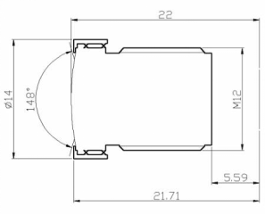
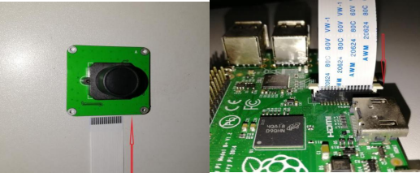

# **CAM-OV5647** **UserManual**


## 1. **General**

CAM-OV5647 is a low-cost wider field view camera module, designed for whole series Raspberry(P4/Pi3 B+/PI3 A+/PI3/PI ZERO/PI ZERO 2W/CM4/CM3+). The CAM-OV5647 has a 5 M Pixel sensor, and connects via a ribbon cable to the CSI connector on the Raspberry Pi. The video and still image quality is better than a USB webcam of similar price.

CAM-OV5647 is a Plug and Play device, driver-free. Support  libcamera and  Rpicam.

## 2. **Features** 

1. The   CAM-OV5647 Module is a low-cost wider field view camera module that designed for all Raspberry Pi. Comes with Pi4 and Pi Zero dedicated cable.

2. Connects to the CSI connector of Raspberry Pi directly. High bandwidth communication from the camera module to the Raspberry pi.

3. On-board OmniVision OV5647[6] Color CMOS QSXGA (5-megapixel); Video: 1080p at 30 fps with codec H.264 (AVC).

4. Len Feature: 2.8 Focal Length. F/NO: 2.2. Field Of view: D=90° H=72°. Element: 4G+IR. CRA: 10°. Relative Illumination: 52%. Focal distance is adjustable.

5. Plug and Play device, driver-free for all raspberry pi board，please download from our website product page or wiki（you can find link from color page）

## 3. **Hardware** **Description**               

### 3.1 Overview                              

|                                       |                                       |
| :-----------------------------------: | :-----------------------------------: |
|              Sensor type              |  OmniVision OV5647 Color CMOS QSXGA   |
|              Sensor size              |       3.67 x 2.74 mm (1/4 inch)       |
|              Resolution               |           5 million pixels            |
|             Field of view             |       Fov(D) = 90° Fov(H) = 72°       |
| Pixel Count(Still Picture Resolution) |              2592 x 1944              |
|             Focal Length              |                2.8 mm                 |
|            Focal Distance             |              Adjustable               |
|            F(N) /Aperture             |                  2.2                  |
|              Pixel Size               |             1.4 x 1.4 um              |
|                 Video                 |    1080p at 30 fps 720p at 60 fps     |
|              Board Size               | 39 x 39 mm (not including flex cable) |
|             TV DISTORTION             |                 <-17%                 |
|                  CRA                  |                  10°                  |
|         Relative Illumination         |                  52%                  |
|    Minimum Object Distance(M.O.D)     |               0.1 meter               |
|                Element                |                 4G+IR                 |
|             Lens Diameter             |                  M12                  |
|           Lens Seat Spacing           |                 22 mm                 |
|            Mounting Holes             |             4x D=2.20 mm              |

### 3.2 Len Size 



### 3.3 Connect





## 4. **Libcamera** **Description**                

Raspberry Pi is transitioning from a legacy camera software stack based on proprietary Broadcom GPU code to an open-source stack based on `libcamera`. Raspberry Pi OS images from *Bullseye* onwards will contain **only** the `libcamera`-based stack. Raspberry Pi OS images up to and including *Buster* will contain the legacy *Raspicam* stack, though the `libcamera` stack and applications can be installed [using *apt*](https://www.raspberrypi.com/documentation/accessories/camera.html#libcamera-and-libcamera-apps-packages), or built by following the [normal build instructions](https://www.raspberrypi.com/documentation/accessories/camera.html#building-libcamera-and-libcamera-apps).

libcamera is an open source Linux community project. More information is available at the [libcamera website](https://libcamera.org/):

The libcamera source code can be found and checked out from the [official libcamera repository](https://git.linuxtv.org/libcamera.git/).

When running a Raspberry Pi OS based on Bullseye, the 5 basic libcamera-apps are already installed. In this case, official Raspberry Pi cameras will also be detected and enabled automatically. Below we only take ‘libcamera-hello’ for example. For more information, please refer to below link： 

https://www.raspberrypi.com/documentation/accessories/camera.html#binary-packages


### 4.1 Rpicam-apps / Libcamera

libcamera is an open source Linux community project. More information is available at the [libcamera website](https://libcamera.org/):

https://libcamera.org/

 

The libcamera source code can be found and checked out from the [official libcamera repository](https://git.linuxtv.org/libcamera.git/).

https://git.linuxtv.org/libcamera.git/

 

Raspberry Pi OS Bookworm renamed the camera capture applications from libcamera-* to 

rpicam-*. Symbolic links allow users to use the old names for now. Adopt the new application names as soon as possible. Raspberry Pi OS versions prior to Bookworm still use the libcamera-* name.

https://www.raspberrypi.com/documentation/computers/camera_software.html#rpicam-apps

https://github.com/raspberrypi/rpicam-apps

#### 4.1.1 Preview

#### 4.1.1 Camera Information

The CAM-OV5647 camera does not require adding `dtoverlay`, as the system will automatically detect it. Once the camera is properly connected, you can view the camera information using the following command.

```
rpicam-hello --list-cameras
```

```
pi@raspberrypi:~ $ rpicam-hello --list-cameras
Available cameras
-----------------
0 : ov5647 [2592x1944 10-bit GBRG] (/base/axi/pcie@1000120000/rp1/i2c@80000/ov5647@36)
    Modes: 'SGBRG10_CSI2P' : 640x480 [58.92 fps - (16, 0)/2560x1920 crop]
                             1296x972 [46.34 fps - (0, 0)/2592x1944 crop]
                             1920x1080 [32.81 fps - (348, 434)/1928x1080 crop]
                             2592x1944 [15.63 fps - (0, 0)/2592x1944 crop]

```

#### 4.1.1 Camera Preview

The following command can be used to directly open the camera preview.  Two cameras can be opened simultaneously.

```
rpicam-hello -t 0 
```

#### 4.1.2 Configuring Camera Mode

You can use the result of --list-cameras, and then specify the camera operating mode with the --mode option in a colon-separated format:

<width>:<height>:<bit-depth>:<packing>

If the values you provide do not match exactly, the system will select the closest available option for the sensor. You can use either packed (P) or unpacked (U) packing formats. This affects the format of stored video and still images, but it does not affect the format of frames passed to the preview window. 

Based on the information shown by the `rpicam-hello --list-cameras` command, set the camera to 

2592(W) × 1944(H) × 10bit @ 15.63 fps mode 

```
rpicam-still --viewfinder-mode 2592:1944:10 --framerate 15.63 -t 0
```

640(W) × 480(H) × 10bit @ 58.92 fps mode 

```
rpicam-still --viewfinder-mode 640:480:10 --framerate 58.92 -t 0
```

